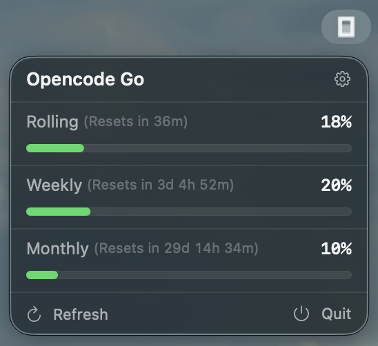

# OpenCode Usage Plus

[](https://github.com/distribate/opencode-usage-plus/actions/workflows/ci.yml)

A native macOS menu bar app that monitors your
[OpenCode Go](https://opencode.ai/docs/console/go/) subscription usage
(rolling 5-hour, weekly and monthly windows).

This is a fork of [wiscaksono/opencode-usage](https://github.com/wiscaksono/opencode-usage)
with two additions:

- **zero-config credentials** — uses the OpenCode sign-in token already stored
  in the local OpenCode database, so no API key is required;
- **24-hour history** — a monthly sparkline built from local samples.



## Features

- **Real-Time Monitoring**: Rolling, Weekly and Monthly usage in the menu bar.
- **Smart Progress Bars**: green / yellow / red depending on usage level.
- **Zero-Config Credentials**: reads the OpenCode OAuth token from
  `~/.local/share/opencode/opencode.db`; an explicit `sk-...` API key can still
  be saved in Settings and takes priority.
- **24h History**: a monthly sparkline from samples taken on every refresh.
- **Auto-Refresh**: every 5 minutes, plus a manual refresh button.
- **Lightweight**: background agent (`LSUIElement`), no dock icon.
- **Terminal-Driven**: plain SwiftPM + Makefile, no `.xcodeproj`.

## Prerequisites

- macOS 26+
- Xcode 26+ (SwiftUI macros require the full Xcode toolchain; Command Line
  Tools alone are not enough to build)
- OpenCode signed in to OpenCode Console with a Go / Go Plus / Go Teams plan,
  or an `sk-...` API key

## Build & run

```bash
make build
make run
```

The app appears in the menu bar. Releases are produced with `make dmg`.

## Credentials

By default the app uses the OAuth access token that OpenCode stores in
`~/.local/share/opencode/opencode.db` (table `credential`). If you are signed
in to OpenCode, there is nothing to configure.

To override it with a dedicated API key:

1. Open the OpenCode console → **Settings** → **API Keys**.
2. Copy the key (starts with `sk-...`).
3. Open **OpenCode Usage Plus** from the menu bar.
4. Click the gear icon, paste the key, and click **Save**.

The API key wins over the OpenCode token. If neither is available, the setup
screen is shown.

Usage history is stored in
`~/Library/Application Support/OpenCode Usage Plus/history.json`
(percentages and timestamps only, last 24 hours).

## Development

| Command | What it does |
|---|---|
| `make build` | Debug build + `.app` bundle |
| `make run` | Build, kill the old instance, launch |
| `make test` | `swift test` |
| `make format` | `swiftformat .` |
| `make logs` | Stream unified logs for `com.distribate.opencode-usage-plus` |
| `make dmg` | Release build + `.dmg` |

CI runs on `macos-26`: formatting, tests, then `make build`. Pushing a `v*`
tag runs the release workflow and publishes a `.dmg`.

## Releases

Pre-built `.dmg` images are published on every version tag in
[Releases](https://github.com/distribate/opencode-usage-plus/releases).

The app is ad-hoc signed (no paid Developer Program), so Gatekeeper may warn
on first launch: right-click the app → **Open** once.

## Credits

- Original app: [wiscaksono/opencode-usage](https://github.com/wiscaksono/opencode-usage)
  by Wisnu Wicaksono, MIT.
- OpenCode Go usage API: `https://opencode.ai/zen/go/v1/usage` (undocumented;
  may change).

## License

MIT. See [LICENSE](LICENSE). The original copyright notice is preserved.
